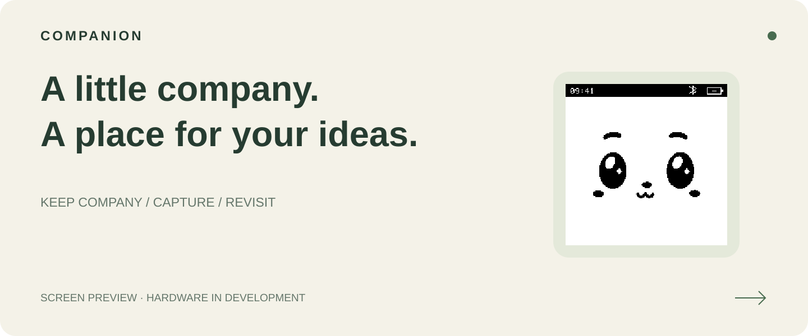

<picture>
  <source media="(prefers-color-scheme: dark) and (max-width: 600px)" srcset="docs/assets/companion/hero-en-mobile-dark.svg">
  <source media="(prefers-color-scheme: dark)" srcset="docs/assets/companion/hero-en-dark.svg">
  <source media="(max-width: 600px)" srcset="docs/assets/companion/hero-en-mobile.svg">
  
</picture>

**English** · [简体中文](README.zh-CN.md)

# Companion Type

**A little companion to keep close, and a place for the words and ideas you want to keep.**

[Meet Companion](#three-everyday-moments) · [First recording](#start-with-a-short-recording) · [Readiness](docs/STATUS.md) · [Device firmware](https://github.com/Listener-ai-Macau/Companion-Firmware)

> **Development candidate · New WBA hardware validation pending.** Software preparation is complete within its stated scope; whole-product acceptance is not. The experience below describes the implemented candidate; physical performance remains unverified.

## Three everyday moments

| Keep it close | Capture the moment | Come back to it |
| --- | --- | --- |
| Expressions, blinking and small pet sounds give your desk or bag a familiar companion. | Start a recording on the device and follow its capture and saving states. | Sync to Type, listen again, search, rename, and turn the transcript into minutes with action items. |

  

Existing screen previews, not hardware photographs or live readings. The first version responds with pet sounds; it does not speak or offer voice conversation.

## Start with a short recording

1. After initial firmware installation, enable pairing on the device, connect in Windows Type and sync its time.
2. Try a pet response outside quiet mode, then hold the physical button for about 700ms while the device is awake. Record about ten seconds and hold again to stop; wait for saving to finish. The first full press from sleep only wakes it; a short press does not start recording.
3. Sync to Type and find the recording in your library. Once the original audio is stored locally, listen back and give it a useful name.
4. Configure transcription and minutes services, then review, edit and export the results.

The first-use guide remembers progress per device. A browser demo cannot complete the real-device checks. USB-C supplies power only; routine device communication uses Bluetooth.

## Keep the audio. Make the content useful.

| Your task | In the Type candidate |
| --- | --- |
| Listen now, organize later | Record first; sync, transcribe and generate minutes afterward |
| Read along at your computer | Online notes with a configured streaming transcription service |
| Find a thought again | Search titles, full transcripts and both minutes variants; play retained local audio |
| Make the notes your own | Edit titles and minutes with manual-source labels, mode isolation and save-conflict checks |
| Take the result elsewhere | Markdown / TXT / JSON; SRT when real timestamps exist; action items remain in minutes, with no separate task/calendar export UI |
| Know what is saved | Separate device copy, transfer, local-save and reclaim status; explicit save retry |

Background recovery does not overwrite manual edits. Explicit regeneration replaces the original recording mode's minutes; viewing another mode does not change that target. Editing clears stale structured action items. Ordinary offline recordings generate minutes for their capture mode; the completed online workflow can generate both mode variants.

## Company at your pace

Standard, Lively and Quiet have clear explanations and a stoppable ten-second silent illustrative preview in Type. Previewing does not apply device settings. Quiet hours need valid device time. Routine pet sounds are suppressed during recording; saving and errors remain visible in status.

## Services and your content

Original audio and the meeting library are local. Cloud transcription sends audio to the selected provider; cloud minutes send relevant transcript text. Bring your own services and credentials; provider prices and quotas apply. Record-first does not mean fully offline recognition, and a configured credential is not proof of a successful service call.

Type's online flow has a 43-minute maximum; the device defaults to 30 minutes. Device settings, storage or faults can stop capture earlier. Gapless continuous segmentation is not available. See [readiness and limits](docs/STATUS.md).

## One product, three parts

| Repository | Responsibility |
| --- | --- |
| Companion Type (here) | Connection, sync, library, transcription, minutes, editing and export |
| [Companion Firmware](https://github.com/Listener-ai-Macau/Companion-Firmware) | Expressions, interaction, capture, storage, Bluetooth transfer, sounds and recovery |
| [Companion Hardware](https://github.com/Listener-ai-Macau/Companion-Hardware) | Electronics, enclosure, manufacturing data and board validation |

Windows is the current desktop product path. Browser and mobile directories are development/demo shells, not a delivered native phone app. No purchase or production-download availability is implied.

[Development and original engineering notes](docs/DEVELOPMENT.md) · [简体中文](README.zh-CN.md)
