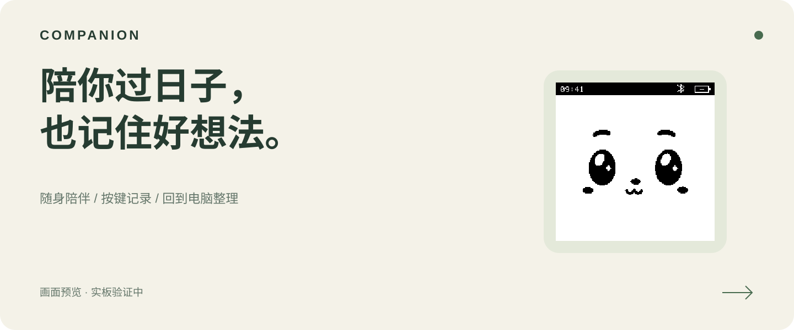

<picture>
  <source media="(prefers-color-scheme: dark) and (max-width: 600px)" srcset="docs/assets/companion/hero-zh-mobile-dark.svg">
  <source media="(prefers-color-scheme: dark)" srcset="docs/assets/companion/hero-zh-dark.svg">
  <source media="(max-width: 600px)" srcset="docs/assets/companion/hero-zh-mobile.svg">
  
</picture>

[English](README.md) · **简体中文**

# Companion Type

**一个愿意带在身边的小伙伴，也给重要的话和突然冒出的想法留个位置。**

[认识 Companion](#三个日常时刻) · [第一次使用](#从一小段试录开始) · [当前进度](docs/STATUS.zh-CN.md) · [固件与设备](https://github.com/Listener-ai-Macau/Companion-Firmware)

> **开发候选 · 新 WBA 实板待验证。** 已完成到板前的软件准备；尚未完成整机验收。下方介绍候选已实现的体验，实物表现仍待验证。

## 三个日常时刻

| 带着它 | 记下来 | 回来看 |
| --- | --- | --- |
| 表情、眨眼、小小的宠物声音。让桌上或包边多一个熟悉的伙伴。 | 在设备上开始录音，看到采集和保存状态，把此刻的话先留下。 | 用 Type 同步，在会议库回听、搜索、改标题，把转写整理成带行动项的纪要。 |

  

已有屏幕画面预览，非实拍；示例状态不是现场设备读数。第一版以宠物音效回应，不说话、不提供语音聊天。

## 从一小段试录开始

1. 首次装好固件后，在设备开启配对，用 Windows Type 连接并同步时间。
2. 在非安静模式下试一次宠物回应，设备醒着时长按物理按键约 700ms 开始，约 10 秒后再长按停止；等待保存结果。睡眠后的第一次完整按压只唤醒，短按不会开始录音。
3. 回到 Type 同步，在会议库确认记录。原音保存在本机后，可回听并起一个好找的名字。
4. 配置转写和纪要服务，再整理文字、检查纪要，按需要编辑或导出。

首次使用向导会记住每台设备的进度。浏览器演示不能替你完成真实设备检查。USB-C 仅供电；日常连接走蓝牙。

## 留下原音，再把内容变得好用

| 想做什么 | Type 候选中的功能 |
| --- | --- |
| 先专心听，之后再整理 | 先录后整理；回到电脑拉录、转写、生成纪要 |
| 连接电脑边录边看 | 在线速记；需要可用的流式转写服务 |
| 找回一句话 | 按标题、转写全文和两模式纪要搜索，回听本地原音 |
| 改成自己的记录 | 编辑标题与纪要；标记人工修改，保留另一模式版本，检查保存冲突 |
| 把结果带走 | Markdown / TXT / JSON；有真实时间戳的转写可导出 SRT；行动项随纪要保存，独立待办/日历入口尚未接入 |
| 知道文件是否安全 | 分开显示设备副本、同步、本机保存及回收；保存失败可重试 |

人工修改不会被后台恢复覆盖。明确点击重生成会替换原录制模式的纪要；查看另一模式不会改变这个范围。编辑后不保留过期的结构化行动项。普通离线录音按原录制模式生成纪要；在线会议完整结束路径可生成两份模式纪要。

## 按你的节奏陪伴

标准、活泼、安静模式有明确说明，Type 提供可停止的 10 秒无声示意预览。预览不改变设备设置。安静时段依赖正确设备时间；录音期间普通提示音被抑制，保存与错误仍通过状态呈现。

## 服务与内容去向

原音和会议库保存在本机。选择云转写会发送音频，选择云纪要服务会发送相关转写文本。自行配置服务和凭据，费用、配额以提供方为准；“先录后整理”不表示无需网络的本地识别。显示“已配置”也不代表服务已经调用成功。

Type 在线流程最多 43 分钟；设备默认 30 分钟，设备设置、剩余空间或故障可能更早停止。当前没有无缝连续分段。详细范围见 [当前进度](docs/STATUS.zh-CN.md)。

## 一个产品，三个部分

| 仓库 | 负责什么 |
| --- | --- |
| Companion Type（这里） | 连接、同步、会议库、转写、纪要、编辑与导出 |
| [Companion Firmware](https://github.com/Listener-ai-Macau/Companion-Firmware) | 表情、交互、录音、存储、蓝牙传输、声音和恢复 |
| [Companion Hardware](https://github.com/Listener-ai-Macau/Companion-Hardware) | 电路、结构、制造资料与实板验证 |

Windows 是当前桌面产品路径；浏览器和 mobile 目录用于演示/开发，不代表原生手机版本已交付。目前尚未提供正式下载和购买入口。

[开发与原工程说明](docs/DEVELOPMENT.md) · [English](README.md)
