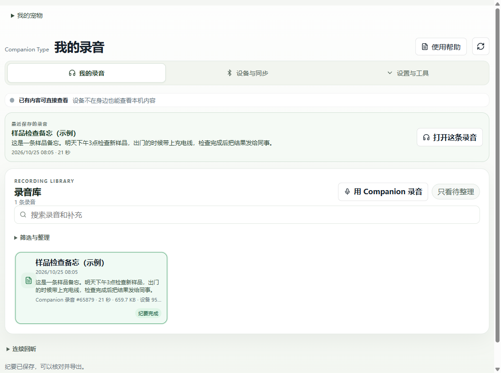
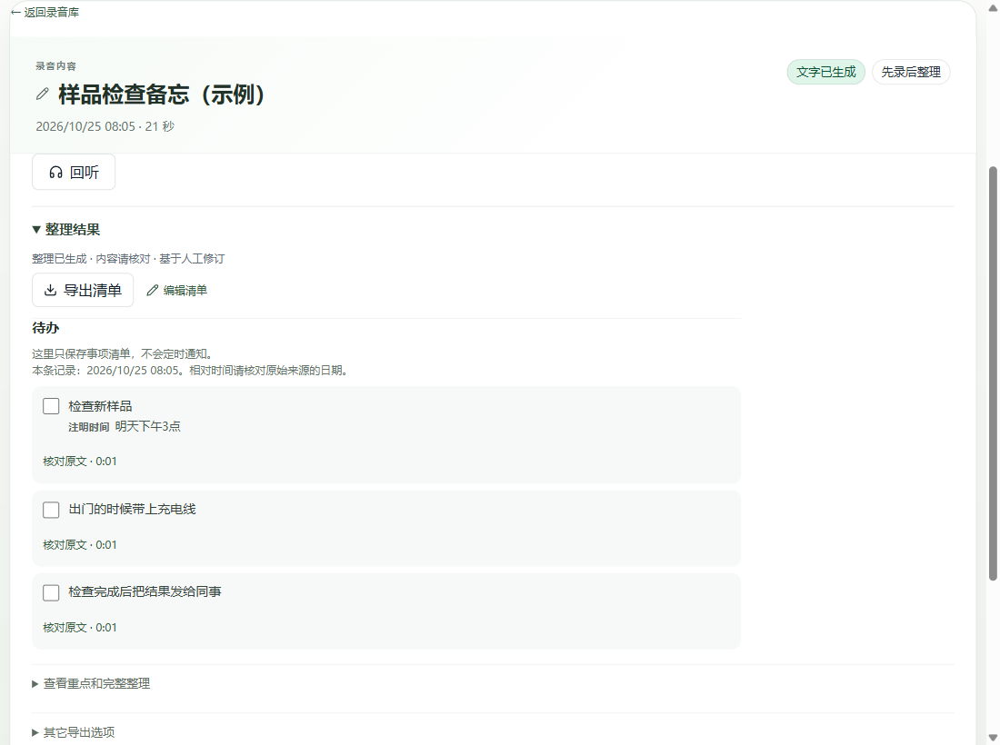
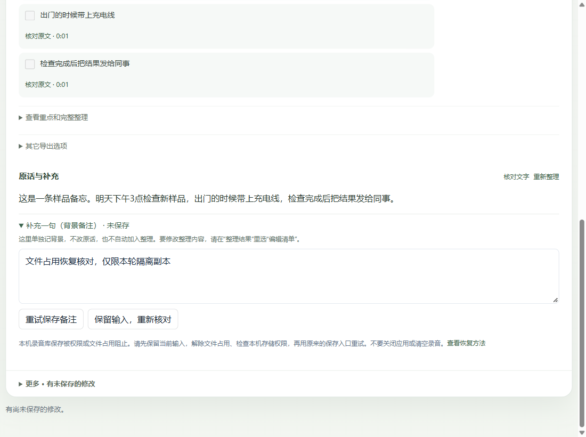

# Using Companion and Type

Record on Companion, then use Type on Windows to find the audio, read its transcript and organize actions. Content already saved on your computer remains readable when the device is away.

This is a development release. Use the matching Windows installer supplied with your delivery. Public downloads, account entitlements and support contacts follow the actual release notice. Native clients for other systems are delivered separately.

[简体中文](USER_GUIDE.zh-CN.md) · [Current readiness](STATUS.md)

## Your first voice memo

1. Install the supplied Windows MSI and open **Companion Type**. Routine data communication uses Bluetooth; USB-C supplies power.
2. Open **设备与同步** (Device and sync). Enable pairing in the pet's menu, then choose **扫描设备** (Scan devices) and **连接 Companion** (Connect Companion). Confirm the system pairing prompt. **检查设备** (Check device) reads status and synchronizes device time; it does not start recording.
3. In that page's **用 Companion 录音** area, select **开始录音** (Start recording), speak briefly, then select **停止并保存** (Stop and save). This route saves original device audio before optional processing; a transcription service is not required to capture it. Use the duration and capacity shown for this attempt.
4. Wait for the original audio to arrive and be saved locally. Open **我的记录** (My recordings). The latest item has **打开这条录音** (Open this recording); you can also search by title, date, duration or a remembered phrase.
5. Read existing text immediately. An audio-only item offers **转文字** (Transcribe); use **整理重点** (Organize key points) when needed. **回听** (Playback) is optional, not a prerequisite to reading text.

For an important meeting, record a few seconds and listen back first. Place the device near the main speaker and away from other conversations and noise. If background sound masks the original voice, transcription and AI summaries may not recover it.

For a meeting on this computer, you can instead open **设备与同步** (Device and sync) and choose **开始录电脑会议** (Start recording the computer meeting). Computer playback and the microphone are saved separately; other computer sounds and nearby conversations may also be recorded.

**Device saved and computer received are separate steps.** A device save notice does not mean the computer has the complete file. Retain device audio while transfer is incomplete.

Screenshots contain example material, not your recordings or live device readings. Bold Chinese labels identify controls in the current Windows interface.

## Where to go

| Page | What it is for |
| --- | --- |
| **我的记录** | Find recordings, read or play them, rename, edit results and notes, export and manage local content. |
| **设备与同步** | Connect and pair, read device capacity and status, control device recording and receive audio. |
| **设置与工具** | Existing service configuration, additional device settings, updates and diagnostics. You do not need this page simply to find a recording. |

If an item is missing, clear search and check the pending-only or other filters in My recordings. If audio is on the device but not the computer, check transfer progress in Device and sync.

## Recording away from the computer

The following entries control the same Companion recording. Choose one convenient method.

| Entry | Start and stop |
| --- | --- |
| Physical button | While awake, hold for about one second to start; hold again to stop. The first complete press from sleep only wakes the pet. |
| Touch shortcut | By default, double-tap the bottom-left of the pet home screen to start, and double-tap the recording screen to stop. Follow the saved gesture if changed; a bottom-left rightward pull is another selectable start gesture. |
| Device menu | Hold still on the home screen for about three seconds. Release after the four blocks complete, then choose **录音 → 开始录音**. |

A short physical press during recording pauses or resumes it; a long press stops it. Check the actual state rather than repeatedly submitting an uncertain action.

The current development firmware also retains screen-debug assignments: **a short press on the awake, idle pet home screen requests a fast full refresh; a double press requests a flashing cleaning refresh**. Neither starts recording. A faulty panel may still fail to complete the request. The first press from sleep only wakes; recording, menu and update states have different button behavior.

Browse menus vertically and use the displayed navigation to return. Physical touch, orientation and sound depend on the matching hardware; a browser preview cannot verify those interactions.

## Transcript Actions and Notes

Speech recognition and organized results are different layers. Check important names, numbers and dates.

| What to change | Entry |
| --- | --- |
| A recognition error or speaker label | Expand **原话与补充**, select **核对文字** and **修正文字**. To fix a repeated term, expand **批量替换文字**, then save the revision. Original recognition and audio remain. |
| An organized action or statement | Select **编辑清单** or **编辑整理内容** in the result, then **保存修改**. |
| Background not spoken in the recording | Open **补充一句（背景备注）**, write it and select **保存备注**. It is stored separately, not presented as original speech or silently added to existing results. |

When regenerating, explicitly choose **原话＋已保存补充** to include saved notes, or **仅原话** to use only the transcript. Regeneration can replace manual edits in the selected result; export important edits first.

For a meeting with many points, read the short **会议概览** if present, then expand the full summary and available source excerpts. Check important names, numbers and actions against the recording. No extracted action does not establish that there was no action.

When no transcription choice has been saved or separately configured, Type defaults to **电脑本地转写（中文）** (computer-local Chinese transcription); a previously saved cloud selection remains in effect. For first use, open **设置与工具 → 转写与纪要服务** and select **准备本地转写模型**. This needs internet and downloads about 240 MB; if the official site is unavailable, a mirror is tried and the file is verified. After the recording is finished and synchronized, select **转文字**. Local transcription does not upload audio. Cloud transcription sends audio to the selected service; intelligent minutes send selected text to the configured service and may incur charges. For long meetings, minutes review may also use nearby transcribed words to flag possible background conversation. This is a prompt for review, not reliable speaker separation or a guarantee of accuracy. A summary containing both meeting content and possible background speech is kept with a review notice.

For a recording-card transcript with unrecognized ranges, expand the list and play a range or choose **重试这段** to retry only that audio. The original recording and transcript are not overwritten. After checking the result, save it as a note and choose **原话＋已保存补充** when regenerating minutes to include it. Notes stay separate from the original transcript; review the generated result. The same model may still miss the same audio. Choosing cloud transcription sends only the selected audio range and may incur charges. This retry is not yet offered for computer dual-track meetings.

If the entire recording produced no transcript, open **回听** (playback), seek to the part to check, and select **转写当前位置起最多 15 秒** to transcribe up to 15 seconds from that position. Review the result and save it as a note if useful. It is only an excerpt, not a transcript of the whole recording. This option is available for a locally playable single-file recording.

Open **向录音提问**, select transcribed recordings and enter a question. The question and selected transcripts are sent to the configured AI service; asking does not upload audio. Answers include source excerpts, but recognition and interpretation still require review. If the service fails, completed answers remain on the current page with the unfinished scope; use **保存回答到备注** to save a chosen answer as a note. Choose **继续查询** to process only unfinished parts, or **重新查询全部** to reprocess everything. Resume state remains only on the current page; after closing it, start a new query. Service requests may incur charges.

Write the action in its content field and time or owner separately. **The checklist does not send scheduled notifications.** “Tomorrow” and “next week” retain the recording's context; compare them with its date.

Exactly matched items offer **核对原文** with a time. Rewritten items that cannot be matched offer **查看原话** without inventing a timestamp.

Wait for a saved confirmation. If the page says unsaved or unconfirmed, retain the input and keep the application open.

## Export and Keep Your Content

Recording details offer optional playback and checklist export. Expand **其它导出选项** for other formats; additional tools appear under **更多** or Settings and tools.

| Format | Use and conditions |
| --- | --- |
| TXT, Markdown and JSON | Existing text or organized results; export does not invoke transcription or regenerate them. |
| Word, PDF and mind map | Create a document from saved results; PDF lets you select included content. |
| SRT | Requires genuine aligned timing. A whole-document rewrite cannot automatically recover alignment. |
| Action list | Uses the current saved actions. Save edits before exporting. |
| Calendar tasks `.ics` | Uses VTODO, requiring a task-compatible application. Explicit dates can become due dates; ambiguous phrases are not guessed. Export does not itself configure a notification in your calendar. |
| Original audio | Choose a local destination for a separate copy; do not overwrite the original in the library. |

You manage exported copies. Device sync is not cross-computer cloud backup. To back up the complete local library, open **我的记录 → 筛选与整理 → 备份与恢复会议库**, select **备份会议库**, and keep the complete resulting folder in a trusted place. On another computer, use **从备份恢复** in the same area and select the complete backup folder; an existing meeting is not overwritten. The folder is not encrypted and contains meeting text, minutes and associated audio. Individual exports and complete-library backups serve different purposes.

Sealed recording segments may be received separately and grouped into one item. Received fragments do not prove a complete session. An interruption or missing-segment notice limits transcription and results to the content actually saved. Pausing sync pauses reception, not an ongoing device recording.

## Recording Space and Duration

Read device recording capacity in **设备与同步**, using **重新读取设备容量** when needed. Compatible devices record without a preset end time until manually stopped or device storage fills; older devices may still require a duration, so follow the current interface. The device checks space before starting and does not automatically overwrite unsynced recordings.

For longer meetings, keep the device connected and syncing where possible so sealed segments can be received while recording. If disconnected, recording uses remaining device space. When storage fills, the captured portion is saved and recording stops; later speech was not captured.

Sync first when space is needed. Type confirms reclaim only after safely saving and checking sealed segments; the growing tail is not deleted early. If **查看可释放的最旧录音** is offered, read its specific contents and loss scope before confirming. That confirmation discards the unsynced content it lists; it is not a recoverable computer recycle-bin action.

## Delete and Restore

Use **筛选与整理** to view the recycle bin. Ordinary removal moves local recordings there and allows restoration. Permanent deletion has a separate confirmation and cannot be undone. Protected recordings must be unprotected before deletion.

Deleting audio, deleting text and deleting an entire item have different scopes. Read the confirmation. Local deletion does not mean deletion from the device, and separately exported copies remain. Protection prevents accidental deletion; it is not encryption.

## Spend Time With Your Pet

Adjust mode, volume or quiet hours in the pet menu, save, then check device state. Standard, Lively and Quiet control interruptions. A silent illustrative preview does not apply a setting. Quiet hours require correct time; use **检查设备** in Type's device page and check the computer's time and timezone if needed. Ordinary short sounds are suppressed during recording.

With working matching touch and motion hardware, gently stroke the home screen, slowly move a finger, or pick up, tilt or lightly shake the pet. Responses merge motion around completed display updates; each contact is not guaranteed an immediate frame. Repeated manual full refreshes are not the interaction method.

Wake a sleeping pet with a short physical press. Closed eyes do not establish the chip's lowest-power mode. The current device has no reliable battery reading, so battery life cannot be estimated; charge it or use stable power before a long recording.

After connecting, expand **我的宠物** at the top of Type:

- **开聊**: speak into the pet microphone and choose **说完了**. Each turn is up to twelve seconds; a short text reply appears at the bottom of the pet screen. The current implementation needs a connected computer and the configured existing services, and does not listen continuously in the background. **取消** ends the current request.
- **名字、性格与记忆**: change names or choose one of sixteen creative personalities, then select **保存性格与称呼**. These are character settings, not a psychological assessment.
- **记住一句**: save only a fact you explicitly confirm. Enable memory use when you want chat to reference it; you can edit, pause use or delete it. Clearing memory and clearing the current conversation are separate actions.

Enter chat with the button. “开始录音” and “聊聊天” remain reserved wake-phrase plans; **a usable wake-word engine is not delivered**. The speaker provides short prompts rather than reading chat replies aloud.

## Recover From a Failure

| Current notice | What to do |
| --- | --- |
| Save unconfirmed, file occupied or permission denied | Retain input and keep the window open. Release the file or check local permissions, then retry through the same save entry. Internal notes do not have a separate destination picker. |
| Local disk full | Free space on the destination disk and retry. Do not clear recordings merely to retry. |
| Computer recording save unconfirmed | Open the recording in **我的记录**. If **尝试恢复录音** is offered, use it to recover written audio. The original file remains; the ending may be missing. |
| Export destination not writable | Release the target file, check directory permissions or choose another local export location. |
| Device recording cannot play | If **尝试恢复回听文件** is offered, try it when original device segments remain on the computer; recovery cannot be guaranteed without valid segments. |
| Automatic sync settings unavailable | Connect the original device and choose **手动同步录音**. During recording, this uses the same session identity. Or choose **修复设置并恢复自动同步** to repair settings and resume automatic sync. This clears previous pause choices for all devices; recordings are retained, and the previous settings file is copied if present. |
| Service configuration, authorization or network failure | Check current settings and service state. If original audio remains, you do not need to record again. Do not include keys in feedback. |
| Device operation unconfirmed | Read current state in Device and sync before repeating start, stop or profile writes. Do not clear pairing or reset the device first. |
| Screen stays still | An e-paper screen retains its previous image. It alone does not establish whether recording continues. Retain content and notices, then check device connection and state. |

Where offered, **查看恢复方法** opens recovery help. Closing help returns to its trigger without clearing your input.

If assistance is needed, note the time, previous action and current notice. **设置与工具 → 日志与诊断** offers a manual local-log export. Review before sharing; omit service keys and audio or transcripts you do not intend to share.

## Updates and Data Destinations

Type updates and pet firmware updates are separate. Type update controls are in Settings and tools. Pet firmware uses a complete matching package supplied with your delivery. End recording and related operations, and save unfinished edits. Before an update, Type first saves unsynced device recordings to the computer; after the save is confirmed, the corresponding device copies may be reclaimed. This does not automatically transcribe them. Then follow the update prompts.

A completed transfer does not establish a successful pet update; wait for confirmation that the new application started. Retain a failed package and notice. Do not mix program and resource files or bypass compatibility and integrity checks.

Original audio and the library are local. Cloud transcription sends the relevant audio; cloud organization sends selected text and explicitly chosen notes. Chat uses the current utterance and memory you allow. Existing services require working configuration and connectivity; fees and quotas follow actual delivery terms. Record-first is not fully local recognition.

## Common Time and Owner Across Items

While editing a checklist with at least two unfinished items, choose **设置共同时间与负责人**. Enter common values once. By default only blank fields are filled, preserving different per-item settings. To replace existing values, explicitly select **同时替换已有值**, review the number of affected items and apply. Empty common fields do not clear existing values; completed items remain unchanged. You can still edit each item separately. Finally choose **保存清单** or **保存修改**. Cancelling the common-fields window does not apply its input.

Choose **确认共同日历日期** to explicitly confirm a date or time once, then review its application to the unfinished items. Date-only values do not invent an hour, and relative wording such as “Saturday” is never resolved automatically. Existing times remain protected unless replacement is selected. Cancelling the date window returns to the common-field draft; cancelling that draft leaves the checklist unchanged. Per-item calendar editing remains available. Save before exporting, importing and checking reminders. **显示文字二维码** displays a text QR code; TXT can also be transferred manually. Neither action automatically synchronizes a phone.

## Data, Costs and Backups

**Record-first means retaining original audio before processing; it does not enable offline speech recognition.** Independent recording is stored on the device first. A computer copy exists after Type synchronizes and confirms it. Recording and retaining audio do not require a transcription service or an offline speech model. **Device and sync → Recording preparation** separates connection, local saving, last-reported capacity and unknown power state. Capacity is a previous report; the device checks again when recording starts.

| Your action | Content stored or sent | Destination and cost boundary |
| --- | --- | --- |
| Record on the device, synchronize audio, view records, write a checklist, save or export | Device audio; synchronized local audio, text, revisions, notes and lists; exported files | These actions themselves do not start cloud transcription or cloud minutes. Device copies, the local library and exports are managed separately. |
| Select computer-local transcription and transcribe a saved recording | Saved recording | Processed on the computer without uploading audio; initial model preparation requires internet and storage. |
| Select cloud transcription, or explicitly select online transcription before recording | The relevant recording or live audio segments | Sent to the selected Volcengine service or configured compatible ASR endpoint. Provider account charges may apply. |
| Generate or regenerate intelligent minutes | The transcript and notes explicitly selected for that request | Sent to the configured DeepSeek or compatible minutes endpoint. This is not local-only processing; charges may apply. |
| Ask a question about recordings | The question and transcripts of selected recordings | Sent to the configured AI service; audio is not uploaded for the question. Continuing sends only unfinished parts; querying everything again resends the selected text. Service requests may incur charges. |
| Explicitly start pet chat | Current utterance audio for recognition; recognized text, conversation context and allowed pet profile/memory for replies | Uses local or cloud transcription as configured; cloud transcription sends audio, and chat text goes to the configured chat service. Charges may apply. It does not listen continuously in the background. |
| Test the transcription or minutes service | One second of fixed silence or fixed test text | Sends a real service request and may incur charges. It does not read your meetings or microphone. Success proves only that particular request. |
| Prepare speaker separation components | Downloads pinned models and runtime files | Does not upload meeting audio. This optional speaker-separation component is not an offline speech-to-text model or a recording prerequisite. |
| Preview or export local diagnostics | Stage events, program fingerprints and local pseudonymous linkage metadata | Saves locally to your chosen file without automatic sharing. Device logs require a separate explicit choice; meeting bodies, original audio and credentials are excluded by default. |

Check the provider, endpoint, model and credentials in **Settings and tools → Transcription and minutes services**. A provider label does not replace the actual destination address. Retention, access controls, billing and availability of a compatible or self-hosted endpoint depend on that service or deployment. Saved settings do not establish available account quota or a successful request.

**The hardware price does not establish included cloud quota or subscriptions.** The application does not confirm a universal free allowance, plan or per-request price; use the actual delivery entitlements and service account. Cancelling, timing out or receiving no usable result after a request was sent does not guarantee that it was free. Retrying transcription, minutes or connection tests may send another request. Editing, saving or exporting existing text does not require another organization request.

Local cleanup cannot retract data already sent to a provider or remove device data, pet memory, other computers, manual backups or exports. Managed files are cleaned only when ownership is established; shared files and unverified legacy caches may remain and are reported in cleanup results. Moving to trash and permanent deletion are separate. Protection prevents accidental deletion; it is neither encryption nor a backup.

**Device synchronization is not cross-computer cloud backup.** After device space is reclaimed, preserve computer audio and needed text yourself. Export important material to a backup location you control and check that the files open. Disabling a service, disconnecting Bluetooth, restoring a name or uninstalling the application does not establish deletion from every location. Before transferring the device or changing computers, check local data, the device, pet memory, exported copies and data already sent remotely separately.

Updated 2 November 2026 for the Windows 0.1.23 engineering candidate. Images are actual Windows interface captures with isolated example material. Other systems, account entitlements, real audio and optical behavior follow their respective deliveries.
