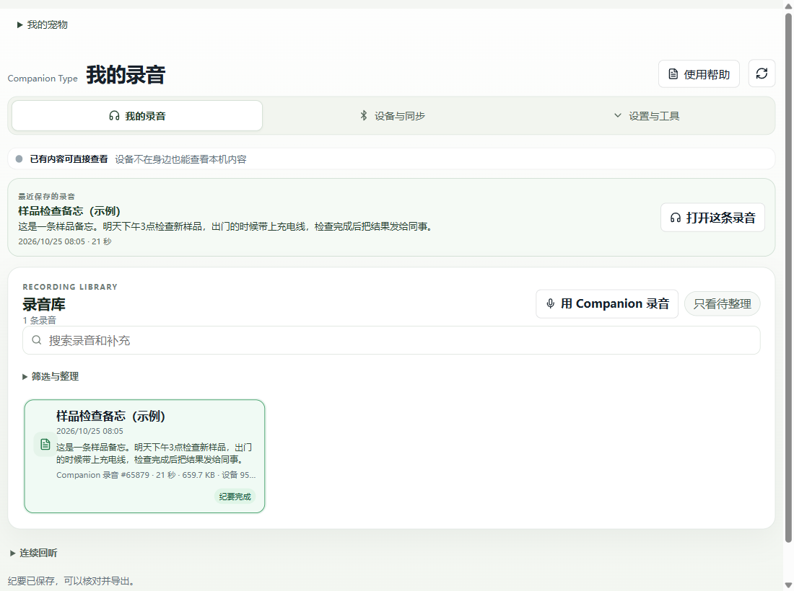
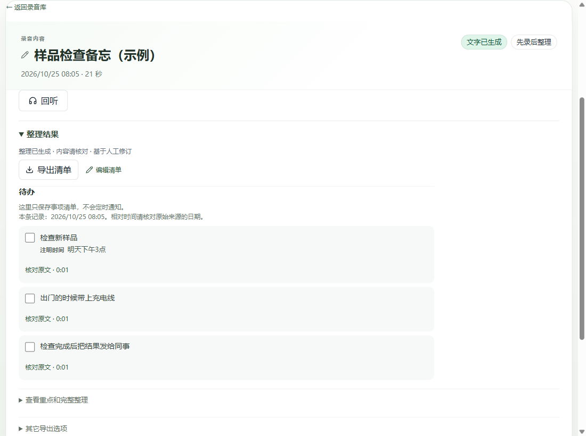
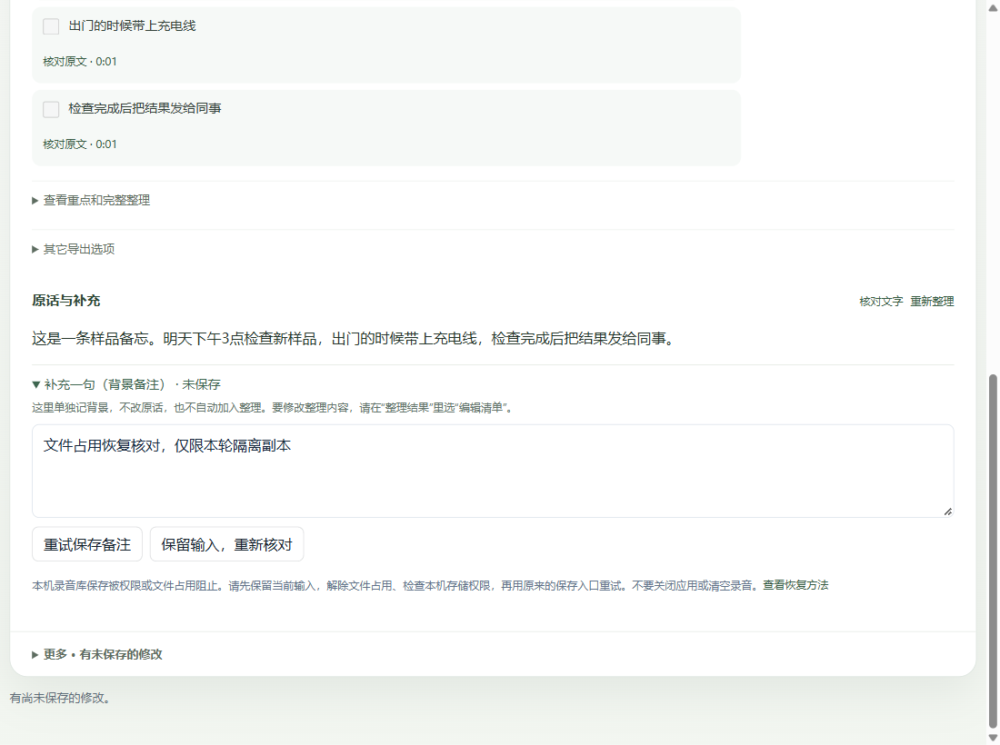

# Companion 和 Type 使用指南

用 Companion 留下原音，再用 Windows 上的 Type 找回、读文字和整理事项。已经保存在电脑里的内容，设备不在身边也能查看。

当前为开发版。请使用交付方提供的配套 Windows 安装包；公开下载、正式账号权益和售后联系方式以实际发布为准。本文对应当前 Windows 界面，其他系统的原生客户端另行交付。

[English](USER_GUIDE.md) · [当前进度](STATUS.zh-CN.md)

## 第一次留下一条备忘

1. 安装收到的 Windows MSI，打开 **Companion Type**。日常数据连接使用蓝牙，USB-C 用于供电。
2. 进入 **设备与同步**。在宠物菜单中开启配对，再点 **扫描设备**、**连接 Companion**。首次连接按系统提示确认配对；**检查设备**会读取状态并校准设备时间，不会开始录音。
3. 在这个页面的 **用 Companion 录音** 区域点 **开始录音**，说一小段话，再点 **停止并保存**。这条入口先保留设备原音，不要求先配置转文字服务。时长和容量以开始前界面的本次读取为准。
4. 等原音同步并在本机保存完成，进入 **我的录音**。最近一条可点 **打开这条录音**；也可按标题、日期、时长或原话片段搜索。
5. 有文字时直接阅读；只有原音时点 **转文字**。需要时再点 **整理重点**。**回听**是可选操作，不必先听完才能看文字。

**设备“已保存”和电脑“已收齐”是两步。** 前者表示设备完成保存，后者还需要蓝牙同步。未收齐时保留设备原音，不要为了重新连接先删除它。

界面截图使用示例备忘，不是读者的录音；截图中的时间、文字和时长不代表当前设备状态。

## 三个页面分别做什么

| 页面 | 常用操作 |
| --- | --- |
| **我的录音** | 找到录音，读文字、回听、改标题，编辑整理结果和备注，导出或管理本机内容。 |
| **设备与同步** | 配对连接、查看容量与设备状态、开始或停止设备录音、收取原音。 |
| **设置与工具** | 查看已有服务配置、更多设备设置、升级、日志与诊断。平常找录音不用先来这里。 |

没找到刚才的内容时，先回到 **我的录音**，清除搜索，并检查是否开启了“只看待整理”或其他筛选。设备上有原音、电脑里还没有时，再到 **设备与同步** 查看收取进度。

## 不连电脑时怎样录音

三种入口控制的是同一台 Companion 的录音，选择顺手的一种即可。

| 入口 | 开始和停止 |
| --- | --- |
| 实体按键 | 清醒时长按约一秒开始，再长按约一秒停止。睡眠后的第一次完整按压只唤醒。 |
| 触摸快捷 | 宠物首页默认双击左下角开始；录音画面双击停止。改过手势时，按设备已保存的设置操作；也可选左下角向右拉开录。 |
| 设备菜单 | 首页静止长按约三秒，四格完成后松手，进入 **录音 → 开始录音**。 |

录音时短按实体键可暂停或继续，长按可停止。请根据实际录音状态操作，不连续重复提交。

当前开发样机还保留了屏幕调试分配：**清醒、未录音的宠物首页，短按请求一次快速全刷，双击请求一次闪烁清理全刷**。它们不会开始录音，也不保证故障屏一定完成刷新。睡眠后的首次按压仍只唤醒；录音、菜单或升级中的按键含义不同。

菜单支持上下浏览和滚动位置提示。按当前页面的返回入口退出，不需要依次尝试所有录音入口。触摸、拿持方向和声音的实际效果取决于配套硬件；浏览器预览不能代替这些操作。

## 文字 清单和补充

打开录音后，文字和整理结果属于不同内容。语音识别可能有错，请核对重要的人名、数字和日期。

| 想修改什么 | 使用哪个入口 |
| --- | --- |
| 原话识别中的错字或说话人 | 展开 **原话与补充**，点 **核对文字**、**修正文字**，保存修订。原始识别结果和原音保留。 |
| 整理出来的事项或说法 | 在 **整理结果** 点 **编辑清单** 或 **编辑整理内容**，修改后点 **保存修改**。 |
| 录音中没说过的背景 | 展开 **补充一句（背景备注）**，写好后点 **保存备注**。补充单独保存，不会冒充原话，也不会自动改变已有整理。 |

需要把补充用于重新整理时，明确选择 **原话＋已保存补充**。只想按录音重新整理，则选 **仅原话**。再次生成可能替换当前版本的人工整理内容，重要修改可先导出。

清单里，内容写要做的事，时间和负责人单独填写。**清单不会到时通知**。原话中的“明天”“下周”指录音当时的语境，请对照记录日期，不要当成今天的相对时间。

能准确对应原文的条目带有 **核对原文** 和时间；改写后不能准确匹配的条目可 **查看原话**，不会给它编造一个录音时间点。

保存后以页面的 **已保存** 结果为准。显示“未保存”或“尚未确认”时，先保留输入，不要关闭应用。

## 导出和保管内容

录音详情里可按需 **回听**、**导出清单**，或展开 **其它导出选项**。更多操作在 **更多** 或 **设置与工具** 中。

| 格式 | 用途和条件 |
| --- | --- |
| TXT、Markdown、JSON | 保存已有文字或整理结果；导出不会重新转文字或重新整理。 |
| SRT | 需要与原音对应的真实时间标记；整段手改文字不能自动恢复时间对齐。 |
| 待办清单 | 来自当前已保存的行动项；先保存修改，再导出。 |
| 日历待办 `.ics` | 使用 VTODO，需要目标应用支持待办。明确日期可保留为截止时间；“周五”等不会自动猜成某个日期。导出不等于已在日历中设置通知。 |
| 原音 | 选择本机保存位置，另存副本；不要覆盖录音库中的原文件。 |

另存文件由你自行保管。自动同步是把设备录音收回电脑，不是跨电脑云备份。设备空间回收后，保存在电脑的原音仍需妥善保管；需要备份时另存原音与所需文字。

录音可能按封口分段收取，再归入同一条记录。**只收到了片段**不等于整场完整；出现中断或缺段提示时，已有内容可先保留，转文字和整理也只覆盖实际保存的内容。暂停同步只暂停收取，不会停止设备正在进行的录音。

## 录音空间和时长

在 **设备与同步** 查看设备录音空间，必要时点 **重新读取设备容量**。电脑发起录音使用下方填写的本次时长；设备独立开录使用设备已保存的时长限制。剩余容量不足时会拒绝开录，不会自动覆盖未同步录音。

需要腾出设备空间时，优先同步保存。Type 安全保存并核对封口分段后才确认回收，正在增长的尾段不会提前删除。若界面提供 **查看可释放的最旧录音**，先阅读确认框中的具体内容和损失范围；确认删除会丢失其中列出的未同步内容，不是可恢复的电脑回收站操作。

## 删除与恢复

在 **筛选与整理** 中查看回收站。普通删除先移入本机回收站，可恢复；**永久清除**会单独确认，完成后不能恢复。受保护的录音需要先解除保护才能删除。

删除音频、删除文字资料、删除整条记录是不同操作，请读确认框中的范围。电脑里的删除不等于删除设备副本，另存的文件也不会跟着删除。保护用于防误删，不等于加密。

## 和宠物相处

在宠物菜单中调整模式、音量或安静时段，保存后以设备状态为准。标准、活泼、安静模式用于控制打扰程度。无声示意预览只演示效果，不会自动应用设置；安静时段需要正确的设备时间。时间不准时，在 Type 的设备页点 **检查设备**，并核对电脑时间和时区。普通短音在录音期间受到抑制。

配套触摸和运动传感器可用时，可在首页轻摸、缓慢移动手指，或轻拿、倾斜和轻晃宠物。动作按屏幕完成节奏合并回应，不保证每个触点都立即显示一帧；不要用反复按键全刷代替互动。

设备睡着时先短按实体键唤醒。闭眼的宠物待机画面不代表已经达到芯片最低功耗。电量是估算值；本版不提供已验证的续航天数。

连接设备后，展开 Type 上方的 **我的宠物**：

- **开聊**：对宠物麦克风说一句，点 **说完了**，每句最多十二秒；短回复显示在屏幕底部。当前需要连接电脑及可用的现有服务，不会后台持续收音。**取消**用于结束当前请求。
- **名字、性格与记忆**：改称呼或选择十六种创作性格之一，点 **保存性格与称呼**。性格参考不属于心理测评。
- **记住一句**：只保存你明确确认的小事；需要聊天引用时，再开启相应记忆开关。可修改、暂停使用或删除。清空记忆与清空本次对话是不同操作。

当前从按钮进入聊天；“开始录音”“聊聊天”是保留的唤醒词安排，**尚未提供可交付的语音唤醒**。扬声器用于短提示，不朗读聊天回复。

## 保存或连接失败后怎样继续

| 当前提示 | 下一步 |
| --- | --- |
| 保存尚未确认、文件被占用或无权限 | 保留输入和窗口，解除文件占用、检查本机权限，再用原保存入口重试。内部备注没有另选保存位置的步骤。 |
| 本机磁盘空间不足 | 释放保存位置所在磁盘的空间，再重试；不要为了重试清空录音。 |
| 导出位置不可写 | 解除占用、检查目录权限，或另选本机导出位置。 |
| 服务配置、授权或网络失败 | 到 **设置与工具** 检查当前配置和服务状态。原音保留时，无需重新录音；不要把密钥写入反馈。 |
| 设备操作尚未确认 | 到 **设备与同步** 读取当前状态，避免连续重复开录、停录或写档案。不要先清配对或恢复默认。 |
| 画面一直不动 | 墨水屏会保留旧画面，不能仅凭画面判断是否仍在录音。先保留当前内容和提示，再核对设备连接与状态。 |

失败位置有 **查看恢复方法** 时可直接打开帮助。读完关闭帮助，会回到触发位置；你的输入不会因为读帮助而被清除。

仍需协助时，记下发生时间、刚才的操作和当前提示。可在 **设置与工具 → 日志与诊断** 手动导出本机日志，确认后再决定是否分享。不要附上服务密钥、未打算分享的原音或完整转写。

## 升级与内容去向

Type 软件更新和宠物固件更新是两件事。Type 更新入口在 **设置与工具**；宠物升级使用交付方提供、与设备匹配的完整软件包。先结束录音和相关操作，保存未完成的编辑，再按界面提示更新。

传输结束不等于宠物升级成功，应等待应用确认新版本正常启动。失败时保留当前包和提示，按恢复说明处理，不自行拼接程序与资源，不绕过匹配或完整性检查。

原音与录音库保存在本机。使用云转文字会发送相应音频；云整理会发送所选文字及你明确选择的补充；聊天会使用本句内容及你允许使用的记忆。使用现有服务时需要可用网络和配置，费用与额度按实际交付说明；“先录后整理”不等于完全本地识别。

更新于 2026 年 10 月 25 日。截图来自 Windows Type 的实际界面，使用隔离示例内容；其他系统、正式服务权益、真实电声与屏幕效果按各自交付确认。
